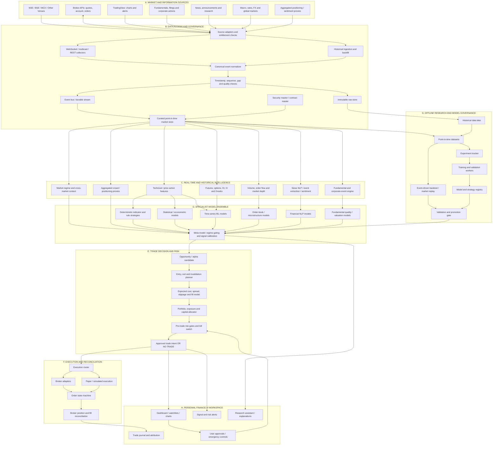

# Finance AI — Personal Multi-Market Trading Intelligence System Design

**Status:** Proposed target architecture (not implemented or validated)  
**Research date:** 2026-11-21  
**Product:** Finance AI  
**Research architecture:** MPFM / multi-model financial intelligence  
**Initial use:** Single-user research, simulation and personal testing  
**Primary objective:** Identify and evaluate potential trade opportunities, entry/exit conditions and risk using multi-source, multi-model analysis.

> This document records the user's clarified product idea and separates it from assumptions that still require research. It is a system-design proposal, not evidence of trading profitability or a recommendation to deploy real capital.

---

## 1. Product idea — the actual target

Finance AI is intended to continuously monitor selected financial markets and instruments, combine multiple families of evidence, and help the user decide:

- Whether a tradable opportunity may exist.
- Whether the market is bullish, bearish, range-bound or in a high-risk/uncertain regime.
- Which entry conditions are satisfied and which are not.
- Where the trade thesis becomes invalid.
- What exit, stop, target, time-stop or trailing conditions may apply.
- Whether the expected opportunity remains attractive after brokerage, statutory charges, spread, slippage, market impact and execution uncertainty.
- When the correct action is **no trade**.

The central product is therefore a **multi-market algorithmic trading intelligence and decision-support system**, with an eventual controlled broker-execution capability. It is not merely a chart dashboard, indicator scanner, chat assistant or price-direction classifier.

The system is intended for the user's own research and testing initially. External customer access, signals-as-a-service, redistribution or commercial operation are out of initial scope and would require separate legal, licensing, security and compliance review.

### 1.1 Desired market coverage

Long-term coverage requested:

- NSE: equities, indices, futures and options.
- BSE: equities, indices and derivatives where supported.
- MCX: commodity futures/options and relevant spot/reference data.
- Cross-market context: global indices, currencies, rates, energy, metals and other relevant instruments.
- Broker connectivity: Upstox, Angel One, Groww and other brokers only where their current APIs, account permissions, market segments and regulatory framework support the required operation.
- TradingView: charting, alerts and/or visual analysis integration where permitted; not treated as the exchange's authoritative source of market data.

These are product targets, not proof that a source or broker adapter is already integrated.

---

## 2. Important terminology: HFT vs algorithmic trading vs AI-assisted trading

The idea contains three different operating modes. They must not be treated as interchangeable.

| Mode | Meaning | Typical system requirement | Initial suitability |
|---|---|---|---|
| AI-assisted decision support | Models analyse markets and show trade candidates; the user approves trades | Live or delayed data, signal engine, clear reasoning and risk display | First |
| Retail algorithmic trading | Rules or models automatically create/manage orders through a broker API | Broker-approved API path, applicable SEBI/exchange compliance, rate limits, static-IP and audit controls where required | After research and paper validation |
| High-frequency trading (HFT) | Latency-sensitive strategies exploit very short-lived market microstructure opportunities | Licensed tick/order-book data, low-latency networking, deterministic execution, specialized infrastructure and potentially exchange co-location | Separate advanced research track |

**Critical correction:** Connecting a Python/Node service to a retail broker WebSocket does not make it an HFT system. Upstox currently documents retail order API rate limits of 10 requests/second for regular algos and 50 requests/second for registered algos, subject to further limits. NSE separately describes co-location facilities for institutional/sophisticated traders. These are fundamentally different operating environments.

A sensible initial target is robust, cost-aware intraday/swing algorithmic decision support. HFT-style market-microstructure research can be developed as a separate lane only after the required data, infrastructure, permissions and economic case exist.

---

## 3. System design principles

1. **One canonical market-data model:** different exchanges and brokers are normalized into a common event schema without losing venue-specific fields.
2. **Exchange data and broker account data are separate planes:** market-data access rights are not implied by a connected trading account.
3. **Research and live runtime are isolated:** model training, notebooks and large batch jobs must not block time-sensitive market monitoring or order handling.
4. **Strategies are modular:** each strategy has an explicit universe, horizon, entry, exit, invalidation, sizing, cost model and risk contract.
5. **Models do not place orders directly:** model outputs become structured candidate signals; a deterministic risk/permission layer decides whether an order can be proposed or submitted.
6. **No-trade is a valid output:** stale data, low confidence, high costs, regime uncertainty, conflicting evidence or risk breaches must be able to suppress a trade.
7. **Every decision is reproducible:** save source timestamps, data version, strategy/model versions, risk checks, signal values, order intents and broker acknowledgements.
8. **Paper-first:** backtest, replay, shadow and paper modes precede any live order-routing capability.
9. **No guaranteed-profit assumptions:** predictive performance, execution quality and net profitability are separate hypotheses that must each be measured.
10. **Capability-aware integrations:** never assume all brokers expose the same segments, depth, history, order types, rate limits or permissions.

---

## 4. High-level architecture

This is a logical target architecture. It does not imply that every box should initially become an independent microservice. Start with modular components and split services only when throughput, fault isolation, deployment cadence or latency measurements justify it.

---

## 5. Data and source strategy

### 5.1 Source categories

| Category | Examples of data | Why it matters |
|---|---|---|
| Trades and OHLCV | Trade price, size, OHLCV, VWAP | Price action, momentum and realized activity |
| Quotes and market depth | Best bid/ask, depth levels, spread, depth changes | Liquidity, imbalance and execution quality |
| Derivatives | Futures basis, open interest, option chain, IV, Greeks, expiry | Positioning, leverage, volatility and hedging context |
| Fundamentals | Revenue, margins, cash flow, debt, earnings, valuation | Business quality and longer-horizon context |
| Corporate events | Results, splits, dividends, buybacks, pledges, filings | Event risk and point-in-time fundamental changes |
| News and announcements | Exchange filings, company releases, licensed news | Catalyst, event classification and sentiment |
| Macro and global | Rates, currencies, energy, metals, global indices | Cross-market drivers, especially for commodities |
| Aggregated positioning | OI changes, participant reports, delivery, breadth, volume profiles | Crowd/positioning proxies; not individual trader identity |

### 5.2 What “crowd behaviour” can and cannot mean

The system can study observable, aggregated market evidence such as:

- Changes in open interest with price and volume.
- Bid/ask depth imbalance and order-flow imbalance, where suitable depth data is licensed.
- Aggressive buyer/seller volume proxies.
- Volume profile, VWAP deviations and high-volume/low-volume areas.
- Put/call activity, implied-volatility skew and futures basis.
- Delivery percentage, market breadth and exchange-published participant positioning.
- Public filings, bulk/block deal disclosures and exchange announcements.

It generally cannot know exactly which individual retail person entered or exited a position. Market depth is not a verified identity map of all traders, and broker-specific account data only represents that broker's permitted account scope. The system should therefore say **“aggregated positioning / crowd proxy”**, not “we know where every trader entered.”

### 5.3 Broker and exchange adapter capability matrix

Build a capability registry per provider, account and segment:

- Instruments and exchange segments supported.
- Historical data resolutions and retention.
- Live feed mode, depth and tick granularity.
- Order types, modify/cancel support and order updates.
- Rate limits, connection limits and token lifecycle.
- Static-IP requirements, API-key restrictions and daily logout rules.
- Account permissions, product entitlements and current terms.
- Permitted display, storage, derived use, non-display use and redistribution.

Official documentation review on 2026-11-21 found:

- Upstox's instrument master includes NSE, BSE and MCX instrument files/segments; this is not a guarantee that every account has every segment enabled.
- Groww's current API documentation says its trading API supports cash and F&O, and commodity/MCX API trading is not currently available.
- Angel One SmartAPI documents streaming and order-status WebSockets; the exact data depth and segment entitlements must be checked against the selected account and current official documentation.
- TradingView's Advanced Charts library does not contain market data. It expects the integrator to supply its own source or a third-party provider. TradingView alerts can send webhook notifications, but webhook delivery is not a guaranteed exchange tick feed or execution channel.
- MCX publishes separate real-time, delayed, end-of-day, bhavcopy and historical feed products. Data use and redistribution are governed by MCX agreements.
- NSE market data has multiple levels, including Level 1, Level 2, Level 3 and tick-by-tick products. NSE has a separate non-display data-use policy covering automated calculations/algorithms used in trading decisions.

Therefore, the system must not scrape websites or reuse a broker's UI feed as a substitute for a properly licensed institutional or exchange feed. Written permission and terms must be reviewed for the exact intended use.

---

## 6. Specialist model and strategy architecture

Multiple models should run as specialist components, not as a large unstructured collection of models voting randomly.

### 6.1 Specialist families

| Specialist | Inputs | Output | Primary horizon |
|---|---|---|---|
| Trend / momentum | Returns, moving averages, relative strength, volume | Trend state and continuation probability | Intraday to swing |
| Mean reversion | Deviations from fair/value anchors, z-scores, volatility | Reversion probability and invalidation | Intraday to short-term |
| Breakout / volatility expansion | Range compression, ATR, volume expansion, realized volatility | Breakout probability and range estimate | Intraday to swing |
| Market regime | Returns, volatility, breadth, correlations, macro context | Trend/range/stress/transition regime | Multi-horizon |
| Order-flow / microstructure | Quotes, trades, depth changes, spread, imbalance | Very short-horizon pressure and liquidity state | Seconds to minutes, data-dependent |
| Options / derivatives | OI, volume, IV, Greeks, skew, basis, expiry | Derivatives positioning and volatility signals | Intraday to positional |
| Fundamental / valuation | Point-in-time filings, financial ratios, earnings and cash flows | Quality, valuation and event-risk state | Swing to long-term |
| News / event intelligence | Licensed headlines, filings, company announcements | Event type, entities, polarity, novelty and impact estimate | Event-driven |
| Cross-market / macro | FX, rates, commodities, global indices, sector proxies | Cross-asset state and relevant drivers | Intraday to macro |
| Meta-model / signal combiner | Validated specialist forecasts, regime, data quality and cost | Calibrated opportunity score or abstention | Strategy-specific |

Technical indicator calculations can be deterministic and low-latency. ML models should be introduced only where they beat simple baselines out of sample. Financial language models should extract structured evidence from text and explain events; do not place a general-purpose LLM in a latency-critical order-entry loop.

### 6.2 Multi-model decision policy

The system should not use “six models say buy, three say sell, therefore buy.”

Instead:

1. Validate each specialist per instrument class, market regime and horizon.
2. Calibrate each model's probability on chronological out-of-sample data.
3. Estimate model reliability conditional on the current regime and input quality.
4. Estimate expected net utility after costs and execution probability.
5. Abstain if inputs are stale, models are out of distribution, evidence conflicts or risk limits fail.
6. Track each model's contribution to every accepted/rejected signal.

The weights of the ensemble must be estimated from past validation data, never manually changed just to make a current trade appear convincing.

---

## 7. Signal contract — what a useful trade recommendation must contain

Every trade candidate should be a structured, auditable object with:

- Instrument, exchange, segment and contract expiry where relevant.
- Signal generation timestamp and data-availability timestamp.
- Strategy ID/version and model versions.
- Trade direction and intended horizon.
- Setup state and evidence summary.
- Entry zone or entry trigger, not an unexplained single price.
- Stop/invalidation condition and why the thesis is invalidated.
- Profit target, trailing or time-based exit logic.
- Expected return distribution and probability estimates.
- Expected spread, brokerage, exchange charges, statutory costs, slippage and market-impact estimate.
- Liquidity and fill-probability estimate.
- Recommended quantity or risk budget, subject to portfolio constraints.
- Maximum acceptable entry drift; cancel if the signal becomes stale.
- Explicit status: WATCH, READY_FOR_REVIEW, APPROVED, REJECTED, EXPIRED, EXIT_REQUIRED or NO_TRADE.

A forecast should not be marketed as certainty. “65% probability” must be calibrated against comparable historical predictions and accompanied by its horizon and evaluation method.

---

## 8. Risk and execution control plane

The risk engine is an independent safety boundary between a signal and an order.

### Pre-trade checks

- Broker, user, instrument and segment permission.
- Algo/API registration status and relevant provider restrictions.
- Market session, instrument status, expiry, price bands and lot/tick constraints.
- Feed freshness, sequence gaps and timestamp health.
- Max order size, position size, leverage, gross/net exposure and concentration.
- Per-trade risk budget and maximum daily loss.
- Maximum open orders and maximum number of simultaneous positions.
- Spread, liquidity, estimated slippage and minimum expected net edge.
- Duplicate-order/idempotency checks.
- Valid stop/invalidation and exit plan.
- Broker funds/margin availability.
- Kill-switch and manual trading lock.

### Execution state machine

`CREATED → RISK_CHECKED → SUBMITTED → ACKNOWLEDGED → PARTIALLY_FILLED → FILLED`

Alternative terminal/recovery states:

`REJECTED`, `CANCEL_PENDING`, `CANCELLED`, `EXPIRED`, `UNKNOWN`, `RECONCILIATION_REQUIRED`.

The system must reconcile its internal order and position state against broker order book, trade book and net positions. A timeout must not be treated as proof that an order failed; check broker state before retrying to avoid duplicate orders.

### Execution modes

1. **RESEARCH:** only historical/offline analysis.
2. **BACKTEST:** simulated historical fills and costs.
3. **REPLAY:** replay recorded market events in event-time order.
4. **PAPER:** live data, simulated order submission and fills.
5. **SHADOW:** calculate what the live strategy would do, but submit no order.
6. **MANUAL APPROVAL:** create an order preview requiring explicit user confirmation.
7. **CONTROLLED LIVE:** only after legal/provider checks, paper/shadow success, operational controls and explicit enablement.

The first personal test release should stop at PAPER/SHADOW or MANUAL APPROVAL. No model should be allowed to bypass the risk engine.

---

## 9. HFT research lane — separate architecture

A genuine HFT track requires a separate technical and economic feasibility study:

- Exchange-authorized high-resolution market data, potentially tick-by-tick/full order-book data.
- Sequence-aware market-data handlers, clock synchronization and packet-loss monitoring.
- Low-latency network and execution infrastructure.
- Exchange/broker connectivity, applicable co-location/DMA arrangements and approvals.
- Deterministic, bounded execution code and robust order-book reconstruction.
- Queue-position, latency, fill probability, adverse-selection and market-impact models.
- Very high-quality event-level backtests/replay with realistic exchange mechanics.
- Operational controls, kill-switch, redundant connectivity and incident response.

Do not assume a general-purpose FastAPI request handler, browser dashboard, LLM call or retail broker REST endpoint is appropriate for the hot path.

The HFT track should not be started until direct-feed rights, infrastructure cost, broker/exchange route, operational permissions and a plausible net-edge hypothesis have been established.

---

## 10. Open-source and research systems to inspect

These are candidates for code/research review, not automatic dependencies. Audit the current repository, license, provider adapters, data assumptions, latency behaviour and maintenance state before adoption.

| Project / research | What to study | Important boundary |
|---|---|---|
| [NautilusTrader](https://github.com/nautechsystems/nautilus_trader) | Rust-native, event-driven multi-asset/multi-venue execution, deterministic simulation, order book and adapters | Strong candidate to study for the event-driven execution/replay architecture; exchange-specific Indian adapter and entitlement work remains |
| [QuantConnect LEAN](https://github.com/QuantConnect/Lean) | Modular event-driven backtesting/live engine, portfolio and brokerage abstractions | Strong reference for strategy lifecycle and reproducible backtest/live parity; inspect actual broker and data support/licensing |
| [FinRL](https://github.com/AI4Finance-Foundation/FinRL) / [FinRL-X](https://github.com/AI4Finance-Foundation/FinRL-Trading) | Financial RL environments, rewards, agents and modular trading research | Research framework, not proof of a profitable trading policy; avoid RL before a strong cost-aware baseline |
| [FinRobot](https://github.com/AI4Finance-Foundation/FinRobot) | LLM-based financial agents and research workflows | Study information retrieval, tool orchestration and analyst workflows; an agent demo is not evidence of executable trading alpha |
| [FinGPT](https://github.com/AI4Finance-Foundation/FinGPT) | Financial text modeling, data curation, sentiment and event extraction | NLP research component; text sentiment is not a standalone trade signal |
| [TimesFM](https://github.com/google-research/timesfm) | Pretrained time-series forecasting, covariates and fine-tuning | Check the exact checkpoint license: the repository currently identifies TimesFM 3.0 weights as non-commercial/non-production by default |
| [FinNLP](https://github.com/AI4Finance-Foundation/FinNLP) | Financial data collection and NLP datasets | Review every upstream data source's terms before reuse |

For order-flow research, inspect empirical work such as “Deep order flow imbalance: Extracting alpha at multiple horizons from the limit order book.” Its results are based on granular Nasdaq order-book data; they cannot simply be assumed to transfer to NSE/MCX or to retail-broker snapshots.

No single open-source project should be adopted as the full Finance AI platform. The intended approach is to reverse-engineer useful architectural patterns and combine compatible components behind Finance AI's own data, signal, risk and audit contracts.

---

## 11. Research and validation methodology

Each proposed strategy/model must have an experiment card:

- Hypothesis and economic rationale.
- Market, instrument universe and point-in-time history.
- Data vendor, permission, data resolution and completeness.
- Prediction horizon and exact target definition.
- Entry/exit and position-sizing rules.
- Train/validation/test dates; chronological walk-forward folds.
- Purging/embargo wherever labels overlap.
- Slippage, spread, brokerage, taxes, exchange charges, market impact and fill assumptions.
- Benchmark and simple baseline.
- Ablation and regime-conditioned performance.
- Probability calibration and uncertainty.
- Net return, drawdown, Sharpe/Sortino, turnover, exposure, hit rate, profit factor, tail loss and capacity measures as appropriate.
- Rejected hypotheses, failed folds and multiple-testing controls.

Evaluate separately:

1. **Forecast quality:** does the model predict the defined target?
2. **Decision quality:** do the forecast and strategy rules identify useful opportunities?
3. **Execution quality:** can those opportunities be filled at realistic prices?
4. **Economic result:** is the net result positive and robust after all costs and risk?
5. **Operational reliability:** can the system preserve correct state during disconnects, partial fills, rejections and restarts?

A profitable-looking in-sample backtest is not sufficient. Require walk-forward evidence, realistic market replay, paper/shadow operation and ongoing drift/incident monitoring.

---

## 12. Implementation roadmap

The existing repository already has a research-grade historical workflow, baselines, walk-forward evaluation, inference API and model-registry/monitoring work recorded. It does **not** currently document live broker order execution. The new system should extend that foundation without pretending those future capabilities already exist.

| Phase | Deliverable | Exit criteria |
|---|---|---|
| P0 — Product and market scope | Define market segments, instrument universe, horizons and manual/paper operating mode | One precise initial use case and target contract |
| P1 — Source and entitlement layer | Broker/exchange capability registry, source adapters, legal/use-rights register | Current official API access and data rights documented |
| P2 — Real-time data foundation | Streaming collectors, canonical events, security/contract master, timestamp and gap checks | Reconnect, dedup, replay and data-quality tests pass |
| P3 — Strategy research engine | Technical, statistical, regime, options, order-flow and event-based baseline strategies | Reproducible backtests with cost models |
| P4 — Specialist model layer | Time-series, news/fundamental and microstructure models | Each component beats its relevant baseline out of sample or is rejected |
| P5 — Signal and decision engine | Calibrated ensemble, entry/exit planner, abstention and risk gates | Deterministic, auditable trade intents and NO_TRADE behaviour |
| P6 — Paper/shadow execution | Broker adapter, paper fills, order lifecycle and reconciliation | Stable operation through faults and edge cases |
| P7 — Controlled live pilot | Permissioned, explicitly enabled small-scale execution | Separate approval after compliance and risk readiness |
| P8 — HFT feasibility | Tick-level data, infrastructure and venue connectivity study | Demonstrated net-edge and infrastructure/economic feasibility before build |

### Recommended first proof of concept

Do not start by integrating every exchange, every instrument, every broker and every model at once.

A researchable starting slice should use one liquid, well-defined Indian-market instrument family, one authorized data route, one broker paper/sandbox route where available, a few interpretable strategies (trend, mean reversion, breakout and volatility/regime filter), a cost-aware event-driven simulator, and a strict no-live-order policy.

Once data correctness and out-of-sample strategy quality are demonstrated, expand the universe to more NSE instruments, derivatives, BSE and MCX according to data/API permissions and independent validation.

---

## 13. India regulatory, API and data-rights findings (reviewed 2026-11-21)

This section is an engineering due-diligence record, not legal advice. Recheck current exchange circulars, broker onboarding conditions and counsel before activating API execution.

- SEBI issued the circular **“Safer participation of retail investors in Algorithmic trading”** on 2025-02-04 (SEBI/HO/MIRSD/MIRSD-PoD/P/CIR/2025/0000013).
- SEBI's 2025-09-30 circular extended the implementation glide path and states that the framework and exchange operational modalities apply to all stock brokers from **2026-04-01**.
- NSE's 2025-05-05 implementation standards describe static-IP mapping for client API access, API key mapping, session logout and other operational requirements. The exact requirements depend on client/algo category and broker implementation.
- NSE's current algorithmic-trading page refers to exchange application documents for Client Direct API and cites later 2026 circulars; the broker's current process must be confirmed.
- Upstox's published retail order API rate-limit table states 10 order requests/second for regular algos and 50/second for SEBI-registered algos, with additional minute/30-minute limits. These limits are not an HFT market-data or execution entitlement.
- NSE sells real-time market data at multiple levels, including Level 1, Level 2, Level 3 and tick-by-tick/full-order-book feeds. NSE's non-display policy explicitly addresses using market data in algorithms and automated trading decisions.
- MCX lists real-time, delayed, EOD, bhavcopy, historical, index and spot-price feed products; data use and redistribution are governed by exchange agreements. MCX's published data-feed material includes distinct arrangements for subscribers, vendors and redistributors.
- TradingView Advanced Charts / Trading Platform do not contain market data; integrators must supply data from their own source or a third party.
- Groww's current Trading API documentation says commodity/MCX trading is not available through its API. Upstox's instrument master lists MCX-related instrument segments, but each account and endpoint entitlement must still be verified.

Official sources:

1. SEBI — [Safer participation of retail investors in Algorithmic trading, 2025-02-04](https://www.sebi.gov.in/legal/circulars/feb-2025/safer-participation-of-retail-investors-in-algorithmic-trading_91614.html)
2. SEBI — [Implementation timeline extension, 2025-09-30](https://www.sebi.gov.in/sebi_data/attachdocs/sep-2025/1759232056254.pdf)
3. NSE — [Retail algo implementation standards, 2025-05-05](https://nsearchives.nseindia.com/content/circulars/INVG67858.pdf)
4. NSE — [Algorithmic trading / Decision Support Tools](https://www.nseindia.com/static/trade/platform-services-non-neat-decision-support-tools-algorithm-trading)
5. NSE — [Non-Display Usage of Market Data policy](https://nsearchives.nseindia.com/web/sites/default/files/inline-files/Non_Display_Policy.pdf)
6. NSE — [Real-time data subscription](https://www.nse.in/static/market-data/real-time-data-subscription)
7. MCX — [Data feed policy and subscriptions](https://www.mcxindia.com/technology/datafeed)
8. MCX — [Technology and services FAQ](https://www.mcxindia.com/faq/technology-services)
9. Upstox — [Market data feed V3](https://upstox.com/developer/api-documentation/v3/get-market-data-feed/)
10. Upstox — [Rate limits](https://upstox.com/developer/api-documentation/rate-limiting/)
11. Upstox — [Instrument master](https://upstox.com/developer/api-documentation/instruments/)
12. Angel One — [SmartAPI documentation](https://smartapi.angelone.in/docs)
13. Groww — [Trade API documentation](https://groww.in/trade-api/docs)
14. Groww — [Trading API segment limitation](https://groww.in/trade-api/docs/curl)
15. TradingView — [Datafeed API](https://www.tradingview.com/charting-library-docs/latest/connecting_data/datafeed-api/)
16. TradingView — [Webhook alerts](https://www.tradingview.com/support/solutions/43000529348-how-to-configure-webhook-alerts/)

---

## 14. Unresolved research questions

1. Which exact instruments and horizons offer a defensible initial research target?
2. Which data provider grants the necessary historical depth, live depth/tick resolution, non-display algorithmic use and storage rights?
3. Can order-flow/market-depth signals add net value beyond bar-based volume/price strategies after costs?
4. Which signals remain robust across NSE equities, index derivatives and MCX commodities, and which require market-specific models?
5. How should news novelty, event type, publication time and market reaction be modeled without look-ahead?
6. Can a calibrated meta-model outperform simple regime-filtered rule ensembles?
7. Does reinforcement learning improve execution or portfolio decisions after realistic costs and constraints, versus simpler control policies?
8. What broker/API route supports compliant paper testing and, later, controlled personal execution?
9. Does an HFT track have a credible data, connectivity, infrastructure and cost justification?
10. Which model and open-source licenses permit the intended local research and any later production use?

## 15. Current status

| Area | Status |
|---|---|
| User's personal multi-market trading-intelligence idea | Clarified |
| Target high-level system design | Designed in this document |
| Existing historical ML research pipeline | Implemented as documented elsewhere in the repository |
| NSE/BSE/MCX live-feed entitlements | Not established |
| Broker account/API connections | Not established by this design |
| Live order execution | Not implemented in the existing MVP |
| Validated multi-market trade strategies | Not established |
| HFT infrastructure or exchange co-location | Not established |
| Reliable net profitability | Unproven |

**Bottom line:** Finance AI should first become a data-correct, cost-aware, researchable and auditable trading-intelligence platform. Broker automation is a later controlled capability. True HFT remains a separate feasibility track—not a label for ordinary retail API trading.
